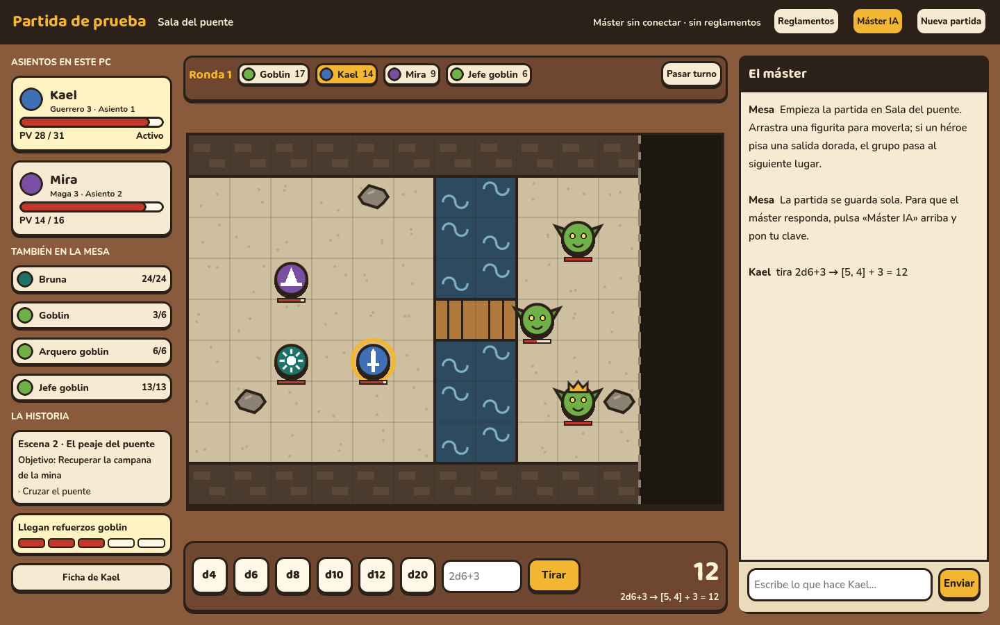

# RoleDMFable

Mesa de rol virtual en 2D, con estética de dibujo animado, en la que una IA hará de máster.
El diseño completo está en el documento del proyecto; este repositorio contiene el juego.



## Estado: fase 1 en marcha (el máster IA ya responde)

Lo que ya funciona, en un solo PC:

- Máster IA: lo que escribes en el chat lo lee Claude, que narra y actúa sobre la mesa con herramientas (tirar dados, mover fichas, daño y curación, medir distancias). El máster no inventa números: las tiradas y los cambios los hace el juego.
- Partida propia: en «Nueva partida» pones nombre a la aventura, dices en una frase de qué queréis que vaya y creáis vuestros héroes con lo básico. Antes de que empiece la historia, el máster crea cada personaje contigo paso a paso siguiendo el reglamento cargado; cuando están todos, abre la aventura con su primer lugar.
- Personajes que duran: cada personaje creado se guarda en tu PC aparte de la partida. Al empezar otra aventura puedes elegir los que vuelven, que entran con su ficha tal como quedó, y lo que ganen jugando (nivel, puntos de vida, equipo apuntado) se conserva.
- Mapas de la aventura: el máster crea los lugares nuevos a medida que la historia los necesita (una posada, una cueva, un camino), con sus paredes, agua, puentes y personajes, y lleva allí al grupo. También pone y quita personajes y cambia el terreno cuando algo se abre, se rompe o se hunde. Los lugares se guardan con la partida.
- Dirección de la historia: el máster lleva un cuaderno con escenas numeradas, objetivo final, objetivos en curso, aliados, enemigos y notas, que se ve en el panel «La historia». Cuando algo del mundo no está decidido no lo inventa a su gusto: pregunta a un oráculo de dados (sí, no, «sí, y además…», «no, y además…»), que a veces trae eventos inesperados. Esos eventos dan puntos de historia y, al llegar al punto de giro, la aventura deja de abrir tramas y va hacia su desenlace. Las amenazas que avanzan se muestran como cuentas atrás.
- Guías de dirección: además de reglamentos puedes cargar libros de consejos para dirigir partidas. No son reglas; el máster los consulta para decidir cómo llevar una escena. Sus instrucciones ya incluyen principios generales de buena dirección (intervenciones cortas, dar autoría a los jugadores, fallos interesantes, dilemas, ritmo).
- Combate por turnos: el máster tira la iniciativa de todos y la barra de arriba del mapa muestra la ronda, el orden y a quién le toca. Los caídos se saltan solos y el botón «Pasar turno» termina el turno actual.
- Hojas de personaje: cada ficha tiene una hoja de datos libres («Fuerza: 16», «Espada larga: +6, daño 1d8+3») que vale para cualquier reglamento. Se edita con «Ficha de …» y el máster la lee y también puede apuntar datos, por ejemplo al crear un personaje contigo.
- Reglamentos: con el botón «Reglamentos» (o arrastrando los archivos a la ventana) se cargan manuales en PDF, Word (.docx) o TXT. El juego los lee una vez, los guarda troceados en tu PC y el máster busca en ellos la regla que necesita, citando libro y página. Sin reglamentos, resuelve con una regla sencilla de 1d20 contra dificultad.
- Exploración fuera de combate: los lugares están enlazados por salidas doradas. Cuando un héroe pisa una, el grupo entero pasa al siguiente mapa, y la niebla se despeja a medida que los héroes avanzan.
- Guardado automático: la partida (lugares, figuritas, niebla y registro) se guarda sola y se retoma al volver a abrir el juego. El botón «Nueva partida» empieza de cero.
- El mapa ocupa siempre el centro de la pantalla y se monta a partir de una escena descrita con datos (`data/scenes/*.json`): terreno, figuritas y zonas sin explorar.
- Figuritas arrastrables con ajuste a la rejilla. El juego rechaza los movimientos a paredes, agua, rocas o casillas ocupadas, y mide la distancia en pies.
- Bandeja de dados con botones rápidos y notación libre: `2d6+3`, `4d6kh3`, `1d20+5-1d4`.
- Asientos: varios jugadores en el mismo PC, cada uno con su personaje. Las tiradas y mensajes quedan firmados por el asiento activo.
- Registro de la partida en el panel derecho, donde habla el máster.

La partida se guarda en la carpeta de datos del juego (`%APPDATA%\\Godot\\app_userdata\\RoleDMFable\\partida.json` en Windows).

Lo siguiente: gráficos definitivos con aspecto 3D, plantillas de área, sonido y partidas en red.

Los PDF escaneados (fotos de las páginas, sin texto seleccionable) no se pueden leer. Los reglamentos no salen de tu PC salvo los pasajes sueltos que el máster consulta, que se envían a Claude como parte de la conversación.

## Conectar el máster

1. Entra en [platform.claude.com](https://platform.claude.com/), ve a «Claves de API» y pulsa «Crear clave». Copia la clave (empieza por `sk-ant-`).
2. En el juego, pulsa «Máster IA» arriba a la derecha, pega la clave, elige el modelo y pulsa «Guardar».
3. Escribe en el chat lo que hace tu personaje.

La clave se guarda solo en tu PC (`ajustes.json`, junto a la partida) y solo se envía a Claude. Cada respuesta gasta un poco del saldo de tu cuenta; la barra de arriba muestra el gasto aproximado de la sesión. No compartas la clave ni la subas al repositorio.

## Cómo abrirlo en Windows

1. Instala el [SDK de .NET 10](https://dotnet.microsoft.com/download/dotnet/10.0) (el «SDK», no el «Runtime»).
2. Descarga **Godot 4.7.1 – .NET** desde [godotengine.org](https://godotengine.org/download/windows/) (la versión que dice «.NET», no la estándar) y descomprímela.
3. Descarga este repositorio (botón verde «Code» › «Download ZIP», o con `git clone`).
4. Abre Godot, pulsa «Importar», elige el archivo `project.godot` de la carpeta y ábrelo.
5. Pulsa F5 (o el botón ▶ de arriba a la derecha) para jugar.

## Estructura

| Carpeta | Qué hay |
| --- | --- |
| `core/` | Reglas en C# puro, sin Godot: dados, escenas, estado de la mesa. Aquí decide el juego, nunca la IA. |
| `master/` | Conexión con Claude: envía el estado de la mesa y ejecuta las herramientas que pide el máster. |
| `rules/` | Lectura de reglamentos en PDF, Word y texto, y su guardado en disco. El buscador está en `core/`. |
| `game/` | Pantallas de Godot: mapa, bandeja de dados, asientos y registro. |
| `data/scenes/` | Escenas de ejemplo en JSON. |
| `tests/` | Pruebas automáticas de `core/` y `master/` (el máster se prueba contra un servidor de imitación, sin clave). |
| `assets/fonts/` | Tipografías Baloo 2 y Nunito, con licencia SIL Open Font (ver los `*-OFL.txt`). |

## Para desarrollar

```bash
dotnet test tests            # pruebas de las reglas
dotnet build RoleDMFable.csproj
```
