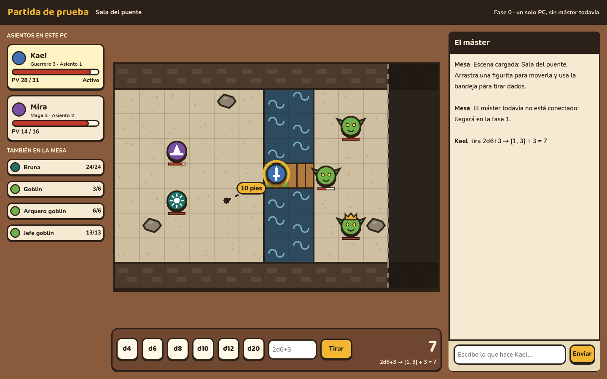

# RoleDMFable

Mesa de rol virtual en 2D, con estética de dibujo animado, en la que una IA hará de máster.
El diseño completo está en el documento del proyecto; este repositorio contiene el juego.



## Estado: fase 0 (cimientos de la mesa)

Lo que ya funciona, en un solo PC y sin máster:

- El mapa ocupa siempre el centro de la pantalla y se monta a partir de una escena descrita con datos (`data/scenes/*.json`): terreno, figuritas y zonas sin explorar.
- Figuritas arrastrables con ajuste a la rejilla. El juego rechaza los movimientos a paredes, agua, rocas o casillas ocupadas, y mide la distancia en pies.
- Bandeja de dados con botones rápidos y notación libre: `2d6+3`, `4d6kh3`, `1d20+5-1d4`.
- Asientos: varios jugadores en el mismo PC, cada uno con su personaje. Las tiradas y mensajes quedan firmados por el asiento activo.
- Registro de la partida en el panel derecho, donde hablará el máster.

Lo siguiente (fase 1): importar reglamentos, máster IA con herramientas y combate por turnos.

## Cómo abrirlo en Windows

1. Instala el [SDK de .NET 8](https://dotnet.microsoft.com/download/dotnet/8.0).
2. Descarga **Godot 4.7.1 – .NET** desde [godotengine.org](https://godotengine.org/download/windows/) (la versión que dice «.NET», no la estándar) y descomprímela.
3. Descarga este repositorio (botón verde «Code» › «Download ZIP», o con `git clone`).
4. Abre Godot, pulsa «Importar», elige el archivo `project.godot` de la carpeta y ábrelo.
5. Pulsa F5 (o el botón ▶ de arriba a la derecha) para jugar.

## Estructura

| Carpeta | Qué hay |
| --- | --- |
| `core/` | Reglas en C# puro, sin Godot: dados, escenas, estado de la mesa. Aquí decide el juego, nunca la IA. |
| `game/` | Pantallas de Godot: mapa, bandeja de dados, asientos y registro. |
| `data/scenes/` | Escenas de ejemplo en JSON. |
| `tests/` | Pruebas automáticas de `core/`. |
| `assets/fonts/` | Tipografías Baloo 2 y Nunito, con licencia SIL Open Font (ver los `*-OFL.txt`). |

## Para desarrollar

```bash
dotnet test tests            # pruebas de las reglas
dotnet build RoleDMFable.csproj
```
