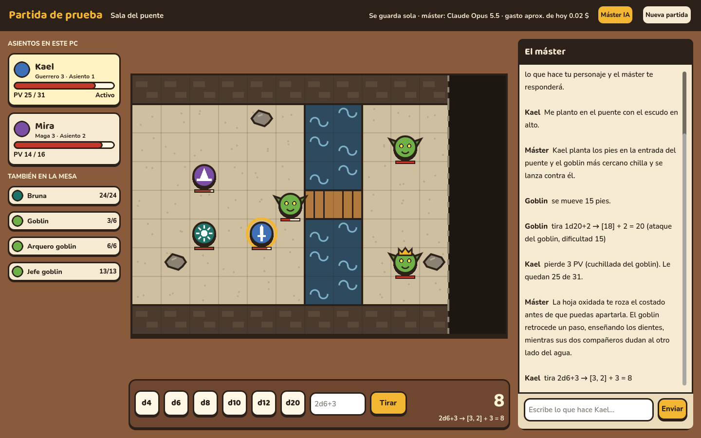

# RoleDMFable

Mesa de rol virtual en 2D, con estética de dibujo animado, en la que una IA hará de máster.
El diseño completo está en el documento del proyecto; este repositorio contiene el juego.



## Estado: fase 1 en marcha (el máster IA ya responde)

Lo que ya funciona, en un solo PC:

- Máster IA: lo que escribes en el chat lo lee Claude, que narra y actúa sobre la mesa con herramientas (tirar dados, mover fichas, daño y curación, medir distancias). El máster no inventa números: las tiradas y los cambios los hace el juego. Todavía no hay reglamento cargado, así que resuelve con una regla sencilla de 1d20 contra dificultad.
- Exploración fuera de combate: los lugares están enlazados por salidas doradas. Cuando un héroe pisa una, el grupo entero pasa al siguiente mapa, y la niebla se despeja a medida que los héroes avanzan.
- Guardado automático: la partida (lugares, figuritas, niebla y registro) se guarda sola y se retoma al volver a abrir el juego. El botón «Nueva partida» empieza de cero.
- El mapa ocupa siempre el centro de la pantalla y se monta a partir de una escena descrita con datos (`data/scenes/*.json`): terreno, figuritas y zonas sin explorar.
- Figuritas arrastrables con ajuste a la rejilla. El juego rechaza los movimientos a paredes, agua, rocas o casillas ocupadas, y mide la distancia en pies.
- Bandeja de dados con botones rápidos y notación libre: `2d6+3`, `4d6kh3`, `1d20+5-1d4`.
- Asientos: varios jugadores en el mismo PC, cada uno con su personaje. Las tiradas y mensajes quedan firmados por el asiento activo.
- Registro de la partida en el panel derecho, donde habla el máster.

La partida se guarda en la carpeta de datos del juego (`%APPDATA%\\Godot\\app_userdata\\RoleDMFable\\partida.json` en Windows).

Lo siguiente: importar reglamentos (PDF, TXT, Word) y combate por turnos.

## Conectar el máster

1. Entra en [platform.claude.com](https://platform.claude.com/), ve a «Claves de API» y pulsa «Crear clave». Copia la clave (empieza por `sk-ant-`).
2. En el juego, pulsa «Máster IA» arriba a la derecha, pega la clave, elige el modelo y pulsa «Guardar».
3. Escribe en el chat lo que hace tu personaje.

La clave se guarda solo en tu PC (`ajustes.json`, junto a la partida) y solo se envía a Claude. Cada respuesta gasta un poco del saldo de tu cuenta; la barra de arriba muestra el gasto aproximado de la sesión. No compartas la clave ni la subas al repositorio.

## Cómo abrirlo en Windows

1. Instala el [SDK de .NET 10](https://dotnet.microsoft.com/download/dotnet/10.0) (el «SDK», no el «Runtime»).
2. Descarga **Godot 4.7.1 – .NET** desde [godotengine.org](https://godotengine.org/download/windows/) (la versión que dice «.NET», no la estándar) y descomprímela.
3. Descarga este repositorio (botón verde «Code» › «Download ZIP», o con `git clone`).
4. Abre Godot, pulsa «Importar», elige el archivo `project.godot` de la carpeta y ábrelo.
5. Pulsa F5 (o el botón ▶ de arriba a la derecha) para jugar.

## Estructura

| Carpeta | Qué hay |
| --- | --- |
| `core/` | Reglas en C# puro, sin Godot: dados, escenas, estado de la mesa. Aquí decide el juego, nunca la IA. |
| `master/` | Conexión con Claude: envía el estado de la mesa y ejecuta las herramientas que pide el máster. |
| `game/` | Pantallas de Godot: mapa, bandeja de dados, asientos y registro. |
| `data/scenes/` | Escenas de ejemplo en JSON. |
| `tests/` | Pruebas automáticas de `core/` y `master/` (el máster se prueba contra un servidor de imitación, sin clave). |
| `assets/fonts/` | Tipografías Baloo 2 y Nunito, con licencia SIL Open Font (ver los `*-OFL.txt`). |

## Para desarrollar

```bash
dotnet test tests            # pruebas de las reglas
dotnet build RoleDMFable.csproj
```
